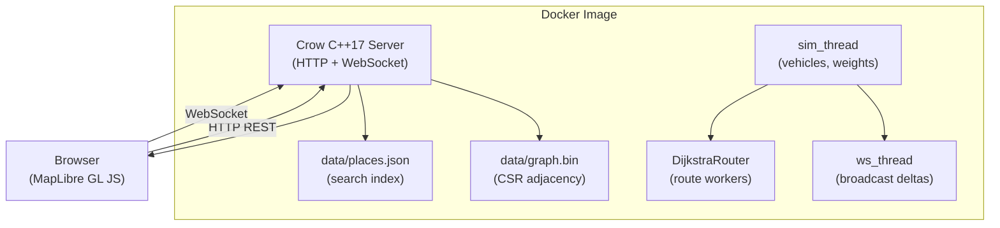

# SmartCity — Architecture

> Generated during Phase 0; updated each phase.

## System Diagram

## Data Flow

1. **Request arrives** at Crow HTTP handler.
2. Handler reads the **current WeightSnapshot** atomically.
3. **DijkstraRouter** computes the route on that snapshot.
4. Response is serialized to JSON and returned.
5. Meanwhile, **sim_thread** ticks every ~1 s:
   - Advances vehicles along edges.
   - Recomputes edge travel times (Greenshields model).
   - Exponentially smooths weights.
   - **Atomically publishes** a new WeightSnapshot.
   - Sends `traffic_delta` + `vehicles` over WebSocket to all subscribers.

## Sequence Diagrams

_Added in Phase 3 (route request), Phase 4 (traffic update), Phase 5 (reroute suggestion)._
